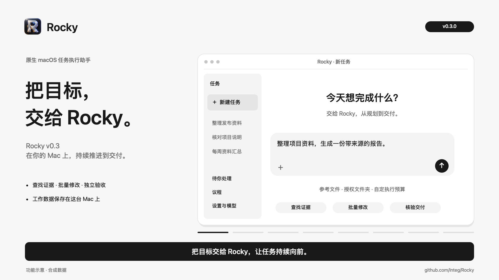
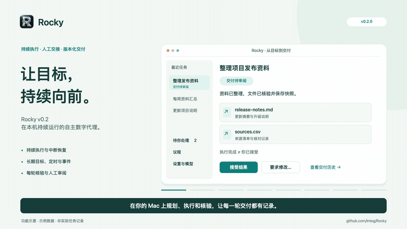
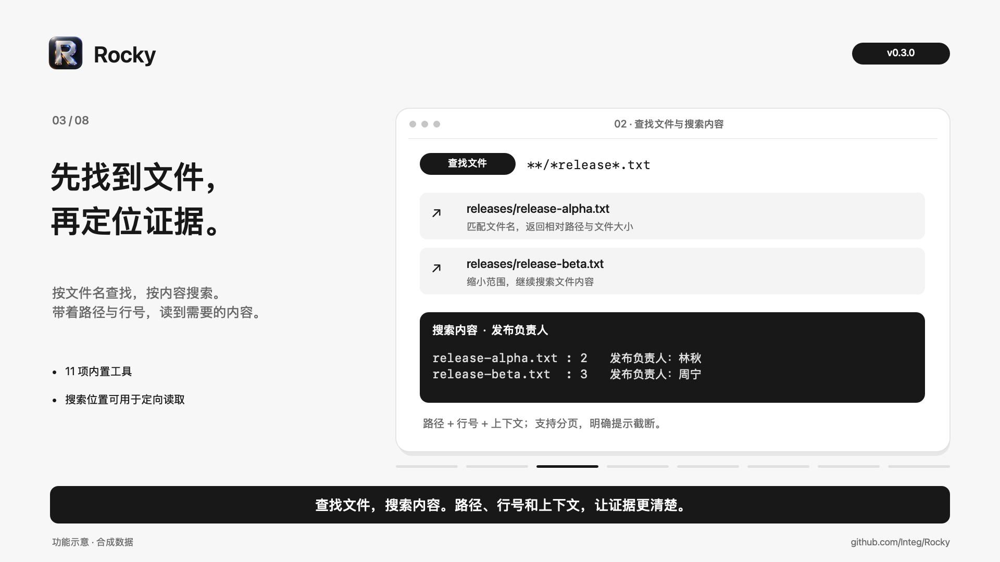
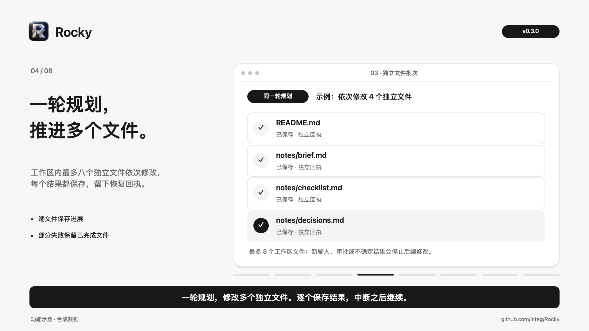

# Rocky

**把目标交给 Rocky，在你的 Mac 上持续推进，直到交付或需要你接手。**

Rocky 是一个长期运行的自主数字代理。你确认目标、验收标准、执行范围和预算，
它负责规划下一步、调用工具、核验文件，并在等待、重启和人工反馈之后继续工作。
Rocky v0.3 提供黑白灰原生界面、11 项内置工具，以及一轮规划中最多 8 个工作区独立文件的修改能力。
从查找资料到保存产物，每一步都有实际结果、执行记录和可恢复的进度。

[下载 v0.3.0](https://github.com/Integ/Rocky/releases/tag/v0.3.0) ·
[一分钟介绍·播音男声版](docs/media/rocky-intro-broadcast-male.mp4) ·
[macOS 使用指南](docs/macos.md) ·
[更新日志](CHANGELOG.md)

[](docs/media/rocky-intro-broadcast-male.mp4)

## 一分钟了解 v0.3

▶ [观看一分钟介绍](docs/media/rocky-intro-broadcast-male.mp4)（60 秒，中文播音男声与字幕） ·
[男声试听](docs/media/rocky-voice-preview.mp3) ·
[下载字幕](docs/media/rocky-intro.srt)

从确认目标开始，依次展示文件查找、内容搜索、独立文件批次、人工交接、交付审阅与后台执行。
画面为基于已实现功能绘制的示意，使用合成数据；旁白由本机 F5-TTS 生成。
[分镜、音色来源与重新生成方式](docs/media/README.md)。

<details>
<summary>查看动画预览</summary>

[](docs/media/rocky-intro-broadcast-male.mp4)

</details>

## v0.3：更快找到证据，更少规划轮次

**先定位，再读取。** `find_files` 按文件名和路径模式定位文件；`search_files` 返回匹配原文、
行号与上下文。两项工具支持分页和并行只读批次，帮助 Rocky 从代码、日志和资料中找到需要的信息。
扫描结果会说明完整性、跳过文件和截断原因。



**一轮规划，推进多个独立文件。** 任务工作区内最多 8 项文件写入、编辑或追加依次执行，逐文件保存结果和回执。
已完成的进展可恢复；新消息、审批要求或不确定结果会停止后续修改，交给下一轮重新判断。



本轮真实模型小样本对比中，跨文件重构通过隐藏测试，模型调用从 **9 次降到 6 次**，耗时从
**82.46 秒降到 53.03 秒**。这组结果反映该次任务，不代表所有任务的提升幅度。
[查看对比方法与记录](docs/reports/2026-11-03-execution-validation.md)。

## v0.3 能做什么

| 能力 | 使用方式 |
| --- | --- |
| **持续执行与恢复** | 规划、工具操作和执行进度持久保存。关闭窗口或退出客户端，后台服务继续执行；重启后从检查点恢复。 |
| **待你处理** | 集中处理操作审批、具体问题、恢复、预算和待审阅交付。补充消息区分“已保存”“已送达”和“已纳入执行”。 |
| **长期目标、定时与事件任务** | 大目标拆成步骤并传递前一步的交付文件；任务可按时间启动，或由文件变化、认证外部事件触发。事件默认仅观察，自动启动设每日额度，建议与历史分别分页。 |
| **交付审阅与历史** | 确定性文件检查与独立模型验收后保存交付快照。你可以接受结果，或在原任务上要求修改；历史版本支持预览、导出和完整性校验。 |
| **看清执行过程** | 显示排队、模型调用、工具操作、重试与剩余预算。模型调用共享全局限额，并为人工请求预留容量；任务记录使用过的提示词模块与版本。 |
| **本地运维** | 查看服务状态、磁盘分类占用和备份；导出不含任务内容、路径或凭据的脱敏诊断 ZIP，由你决定是否分享。支持每日备份、恢复和令牌轮换。 |
| **多模型与工具** | 支持 OpenAI、第三方兼容 API、Anthropic 和本机 Ollama；可操作文件、HTTP、独立登录会话、需要 JavaScript 的网页和脚本，按范围与审批策略执行。 |

任务数据、消息、执行记录与产物保存在本机。分层上下文保留目标、进度、交接摘要、近期记录和相关知识；
跨任务长期记忆由你确认保存，可纠正或撤回。原生 SwiftUI 应用是唯一客户端，执行内核使用 Python、
Temporal 和 SQLite / PostgreSQL。实现细节见[架构说明](docs/architecture.md)。

## 开始使用

1. **安装应用**：从 [v0.3.0 Release](https://github.com/Integ/Rocky/releases/tag/v0.3.0) 下载
   `Rocky-0.3.0-macos-arm64.zip`，解压后将 `Rocky.app` 拖入“应用程序”。需要 Apple Silicon 和 macOS 14+，
   包内包含 Python 与锁定依赖，首次准备运行环境无需联网。此构建为临时签名、尚未经过 Apple 公证，macOS 可能要求手动允许打开。
2. **配置模型**：打开“设置与模型”（`⌘,`），选择服务商或填写兼容 API 地址、模型和密钥。
   密钥保存到 macOS 钥匙串；使用 Ollama 时，先在本机启动它并下载模型。
3. **确认任务要求**：`⌘N` 新建任务，描述目标、附加参考文件或授权文件夹。Rocky 拟定验收标准、
   交付路径和预算；你核对、修改后再开始，`⌘↩` 提交。
4. **需要你时接手**：在“待你处理”中批准具体操作、回答问题或恢复任务。需要审批、等待回复和任务结束时会发出系统通知。
5. **审阅交付**：预览或导出文件，选择“接受结果”或“要求修改”。修改沿用原任务工作区与进度，旧一轮的交付快照仍可查看。

后台服务通过 launchd 常驻运行；若系统要求批准，请在“系统设置 → 通用 → 登录项与扩展”中允许 Rocky。
Mac 有任务执行时会阻止空闲睡眠；**合盖或手动睡眠时任务暂停，唤醒后继续**。
数据目录为 `~/Library/Application Support/Rocky/`。已结束任务可以存档；删除会同时移除执行记录、工作区和交付文件。

Rocky 面向一位所有者在一台 Mac 上使用。**本机保存数据不代表模型请求都留在本机**：选用云端模型时，
任务上下文会发送给你配置的服务商。完整工具权限也不会关闭审批；无人回应的审批不会自动获准。
独立模型核验不能代替你对重要事实和结果的复核。

从 0.1 升级前，应结束旧执行循环中尚未完成的 Temporal 任务，再按原目标重新提交；已有记录和工作区会保留。
完整操作、权限边界与升级说明见 [macOS 应用指南](docs/macos.md)。

## 从源码构建 macOS 应用

在 Mac 上安装 Xcode Command Line Tools 后运行：

```bash
./scripts/build_macos.sh
open dist/Rocky.app
```

构建脚本捆绑 uv、经过校验的 Temporal 本地引擎、Python 和锁定依赖，输出当前 Mac 处理器架构的应用。
开发构建采用临时签名；使用自己的 Developer ID 签名与 Apple 公证的要求见[分发说明](docs/macos.md)。
日常使用无需保留终端、运行 Docker 或打开浏览器。

文档索引见 [docs/](docs/README.md)。以下内容供单独调试后端、工具权限与执行机制时参考。

## 后端开发

macOS 应用会自行启动执行内核。单独调试后端时，可使用以下命令行工具启动服务和提交测试目标。

需要 Python 3.12+、[uv](https://docs.astral.sh/uv/) 和
[Temporal CLI](https://docs.temporal.io/cli/setup-cli)。复用已导出的
`OPENAI_API_KEY`，无需将密钥写入文件。

```bash
git clone https://github.com/Integ/Rocky.git
cd Rocky
uv sync --frozen
mkdir -p data
temporal server start-dev --headless --db-filename data/temporal.db
```

保留 Temporal 终端，另开终端运行 `uv run rocky api`，再开一个运行
`uv run rocky worker`。也可用 `uv run rocky serve` 在一个进程中托管 API 和 worker（设置
`ROCKY_TEMPORAL_BIN` 时同时托管 Temporal）；它使用 `data/api-token` 中的持久令牌并强制 token 模式，
任一子进程退出即整体以非零状态退出，供 launchd/systemd 重启。三个进程从同一仓库目录启动；本机默认无需设置
`ROCKY_API_TOKEN`，worker 需要现有 `OPENAI_API_KEY`。本地默认 SQLite；
`ROCKY_DATABASE_URL` 可以指向 PostgreSQL。

在同一仓库目录提交目标：

```bash
uv run rocky submit examples/hello.json --idempotency-key hello-001
uv run rocky list
uv run rocky get GOAL_ID
uv run rocky events GOAL_ID
uv run rocky wake GOAL_ID "补充信息：所需资料已就绪"
uv run rocky cancel GOAL_ID
```

`GOAL_ID` 替换为提交结果中的 ID。产物在 `data/workspaces/GOAL_ID/`。
同一 idempotency key 和契约返回同一目标；更改契约需要新 key。
`/health` 仅表示 API 进程存活，不表示 worker 已连接。

独立启动后端时默认 `ROCKY_AUTH_MODE=local`，API 只允许回环地址绑定和本机请求，
并检查 Host、Origin 与跨站请求标记。本机模式中的任意本地程序均可调用 API。
对外反代、隧道或非回环部署请设置 `ROCKY_AUTH_MODE=token`，并配置 `ROCKY_API_TOKEN`。
macOS 后台服务固定使用回环地址和保存在 `data/api-token`（权限 0600）的持久 API 令牌。

首次启动、尚未保存模型设置时，`ROCKY_MODEL` 与可选的 `ROCKY_REASONING_EFFORT`
提供后端初始默认值（未设置时为 `gpt-6.1-sol`；设置页另有 Claude 5.5、DeepSeek、OpenRouter 和 Ollama 预设）。已保存的旧模型 ID（如 `gpt-4.1-mini`、`claude-sonnet-4-5`）继续可用。旧版任务未记录模型配置时继续使用 worker 的环境配置；
单独调试时请为 API 和 worker 设置相同的初始值。

## 后端 Docker Compose

用于独立调试执行内核，需要正在运行的 Docker。保留已导出的 `OPENAI_API_KEY`，设置应用凭证：

```bash
export ROCKY_API_TOKEN="$(python3 -c 'import secrets; print(secrets.token_urlsafe(32))')"
export ROCKY_POSTGRES_PASSWORD="$(python3 -c 'import secrets; print(secrets.token_hex(24))')"
docker compose up --build -d
```

Compose 显式使用 `ROCKY_AUTH_MODE=token`，因为容器内请求来自容器网络。
它包含 PostgreSQL、持久化 Temporal 开发服务、API 和 worker。API 只绑定
本机回环地址；模型密钥只传给 worker。应用数据、产物/回执和 Temporal 历史分别
保存在命名卷。`docker compose down` 保留卷；加 `-v` 会删除数据。
容器产物可通过 `docker compose cp worker:/app/data/workspaces/GOAL_ID ./artifacts` 导出。

这是本地评估配置。生产部署需要 TLS、Temporal 服务认证、备份恢复与监控。
详情见 [架构说明](docs/architecture.md)。

## 目标示例

```json
{
  "objective": "创建项目说明，解释 Rocky 的持久执行机制",
  "acceptance_criteria": ["说明重启恢复、执行上限和取消行为"],
  "deliverables": [{"path": "report.md", "min_bytes": 100}],
  "limits": {
    "max_steps": 100,
    "max_model_calls": 150,
    "max_tokens": 500000,
    "timeout_seconds": 3600
  }
}
```

默认 `ROCKY_TOOL_ACCESS=full`。完整权限模式提供 `read_file`、`write_file`、`append_file`、`edit_file`、`list_files`、`find_files`、`search_files`、`fetch_url`、`http_request`、`browse` 和 `run_command`；支持 HTTP/HTTPS 地址、私网、本机服务、重定向、POST 表单/JSON、认证请求及登录 Cookie 会话，下述 Rocky 控制端口除外。旧任务中保存的 `allowed_tools` / `allowed_domains` 不再限制执行。

`find_files` 按文件名或相对路径 glob 递归定位文件；`search_files` 在 UTF-8 文本中进行字面搜索，返回路径、一基行号及可选上下文，两者均可加入最多 8 项的只读并行批次，无需 shell。`path` 指定目录，`content` 为 JSON：例如 `{"glob":"**/*.py"}` 或 `{"query":"compute_total","glob":"*.py","context_lines":1}`。支持 `limit`（1–200）、`offset` 和显式 `include_hidden`；内容搜索还支持 `case_sensitive`。默认跳过隐藏文件、依赖与缓存目录，始终不跟随嵌套符号链接，不读取硬链接和特殊文件；内容搜索跳过二进制、非 UTF-8 和超过 1 MB 的文件。结果包含完整性、跳过数量及截断原因；分页使用 `next_offset`，扫描限额则应缩小目录或模式。个人目录与凭据的审批规则仍然有效，旧 scoped 任务须在 `allowed_tools` 中列出新工具。

搜索行号按 LF 分行，与定向 `read_file` 一致；CRLF 的行尾会规范化，Unicode 分隔符和分页符保留在同一物理行中。依赖目录的排除规则只作用于目录，不会排除同名普通文件。

Python 文件工具可使用绝对路径和隐藏文件，但包括 `full` 模式在内，一律禁止访问工作区根目录中的其他任务和私有 `.rocky/` 控制目录；路径遍历、符号链接和硬链接也不能绕过限制。读取、写入、追加、编辑、目录列表、HTTP 下载目标及验收文件读取都遵守此边界。提交任务时可以授权文件夹（合同的 `folders`，客户端在输入框点文件夹按钮或拖入文件夹）：任务可以像在自己目录里一样直接读写这些文件夹，Seatbelt 也允许沙箱命令写入。授权文件夹必须已存在，不能是根目录、家目录本身，也不能包含或位于 Rocky 自己的数据、代码或凭据存储中。也可以附加文件作为参考资料（合同的 `files`，客户端拖入文件或在同一个按钮里选择文件）：任务可以直接读取这些文件，但不能修改；附加的文件必须存在，且不能是凭据或 Rocky 自己的文件。在 `required` 审批模式下，写入、追加、编辑或下载到任务目录和授权文件夹之外的路径（包括经任务内符号链接指向外部的路径）、读取或列出凭据存储（`~/.ssh`、`~/.aws`、`~/.gnupg`、`~/.netrc`、`~/.config/gh`、`~/Library/Keychains`、浏览器配置等），以及读取或列出家目录下任务目录和授权文件夹之外的个人文件，都需要所有者逐次批准完整操作，所有者规则和本任务同类授权都不能放行。家目录之外的系统和工具链文件可直接读取。产物相对路径用于结果核验和导出。

macOS 上的 `run_command` 默认通过 `/usr/bin/sandbox-exec -p <按 goal 生成的 SBPL profile>` 执行。命令只能写当前任务目录，不能读写其他任务或 `.rocky/`；临时文件、Python/uv/pip/npm 缓存位于任务内的 `.rocky-sandbox/`，因此 `uv`、`git`、`python` 可正常创建项目、虚拟环境及缓存。子进程和后台作业继承同一 Seatbelt 限制。上述凭据存储在沙箱内不可读，需要它们的命令（如走 SSH 的 `git push`、`gh`、`aws`）须申请 `sandbox=false`；其他普通文件可读，网络访问继续开放；此机制提供文件及进程隔离，不提供网络隔离或资源配额。非 macOS、缺少 Seatbelt 或系统拒绝加载 profile 时，命令执行失败，不会自动降级为无沙箱执行。

后台服务的 Rocky/Temporal 及常见 API 凭据环境变量不会传给沙箱命令，Python/uv 也不会继承后台服务的虚拟环境配置。配置中的凭据文件、SQLite 数据库及其 WAL/SHM/回滚日志，以及 `rocky serve` 的 API 令牌、Temporal 数据库、`run/` 状态目录和日志目录（`ROCKY_API_TOKEN_FILE`、`ROCKY_TEMPORAL_DB`、`ROCKY_RUN_DIR`、`ROCKY_LOG_DIR`），文件工具和沙箱命令都不能读写；文件工具也不能改写正在运行的 Rocky 代码或 Python 环境。命令和 HTTP 工具（包括重定向）不能连接配置的 Rocky API、Temporal 目标端口，防止任务调用控制接口自行审批。这些端口在所有目标地址上保留，普通外部服务若使用相同端口也会被阻止。

`http_request` 的 `content` 为 JSON 配置，例如 `{"method":"POST","data":{"username":"…","password":"…"},"session":"platform"}`；后续请求使用相同 `session` 自动携带 Cookie。可用 `headers` / `json` / `body` / `auth` 配置其他认证方式，`path` 保存完整响应文件。会话按任务和名称隔离，私有持久存储，重启后可复用。`run_command` 的 `content` 为 Shell 命令，`path` 可指定工作目录。单次 HTTP 请求最多 30 秒。命令默认最多 30 秒，可用 `timeout_seconds` 申请最长 900 秒（构建、安装依赖、测试套件）；命令返回时它留下的子进程会被结束。更长的工作或需要一直运行的服务用 `background: true` 作为后台作业启动：调用立即返回作业 ID，输出写入任务目录的 `.rocky-jobs/<id>.log`，结束后在 `.rocky-jobs/<id>.exit` 写入退出码。每个任务最多同时 4 个后台作业，单个最长 6 小时，任务结束或删除时全部停止。`timeout_seconds` 和 `background` 属于审批内容，改动它们会使原审批失效。

`ROCKY_APPROVAL_MODE=required` 是默认值：每条 Shell 命令，以及 GET/HEAD/OPTIONS 以外的 HTTP 请求，都要先经过分级审批。审批绑定任务、操作 ID 和完整参数，普通唤醒消息或网页中的“已批准”不会授权。依次检查：

1. **只读命令**：在 Seatbelt 内运行的简单只读命令直接执行，包括 `ls`、`cat`、`head`、`tail`、`wc`、`grep`、`rg`、`find`、`stat`、`du`、`diff`、`jq` 等；会写文件或执行其他程序的参数（`find -exec/-delete`、`sort -o`、`tail -f`、`rg --pre` 等）、未加引号的通配符和 `~` 展开仍需批准。程序必须解析到任务工作区之外。参数或工作目录指向家目录下任务目录和授权文件夹之外的个人文件（或包含家目录的目录，如 `/Users`）时，只读命令也需要批准。`git` 不在其中，因为仓库配置（如 `core.fsmonitor`、diff 驱动）可以执行任意程序，而任务能写这些配置。`ROCKY_AUTO_APPROVE_READ_ONLY=false` 或客户端“审批”页可关闭。
2. **所有者规则**：命令前缀（如 `uv run pytest`），或某个精确来源上的 HTTP 方法（如 `POST https://api.example.com`，可限定路径前缀）。规则保存在 Rocky 数据库，命令和文件工具都无法改写；客户端审批卡片的“以后始终允许”、“审批”页手动输入或一键添加常用命令，或 `POST /approval-rules` 添加，`DELETE /approval-rules/{id}` 删除。`ROCKY_AUTO_APPROVE_COMMANDS=ls,git status,uv run pytest` 仍可配置环境变量白名单。
3. **本任务授权**：“本任务内批准同类”或 API 的 `{"fingerprint":"…","scope":"task"}` 让本任务后续同前缀的简单命令，或同方法、同来源的 HTTP 请求直接执行。
4. **等待所有者**：其余操作暂停等待批准。`POST /goals/{id}/approve` 接受 `scope` 为 `action`（默认）、`task`、`always`、`deny`。`GET /approvals` 列出所有未结束任务的待批与超时未批请求，`POST /approvals/batch` 一次处理多条。

无人回应的请求在 `ROCKY_APPROVAL_TIMEOUT_MINUTES`（默认 30，0 表示一直等待，客户端可改）后**只会被拒绝，绝不会自动批准**（选“一直等待”时会一直等到你处理或取消，期间不计时）：操作不执行，模型收到 `approval_timeout` 并改做不需要审批的工作，该请求进入任务的“超时未批”列表。所有者之后用 `scope` 为 `deferred` 批准它，任务会被唤醒，并可原样执行这一操作一次；`dismiss` 将其移除。连续 3 次超时后任务转为等待输入。含 `;`、`&&`、`|`、重定向、`$`、反引号或换行的命令永远不匹配前缀与只读规则，`sudo`/`env`/`xargs` 等包装命令和 `python -c` 这类内联代码不会提供同类批准。执行记录中的 `approved_by` 注明每个免审操作由哪一级放行（`read_only`、`allowlist`、`rule:<id>`、`task`、`deferred:…`、`owner`、`trusted`）。明确接受命令自行执行的单机所有者可配置 `ROCKY_APPROVAL_MODE=trusted`；完整工具权限本身不会关闭审批。此门禁按工具/方法分类，不能识别具有副作用的 GET 接口；带请求体或 URL 超过 2048 字符的 GET/HEAD/OPTIONS 按写入请求审批，以免把文件内容夹带出去。短 GET 仍可携带少量数据，这是保留的风险：个人文件读取需批准正是为此设置。所有者规则放行的命令（如 `uv run pytest`）在沙箱内运行任意项目代码，同样不受个人文件读取限制。任务目录和授权文件夹内的文件写入无需审批。

`browse` 用无界面浏览器打开需要 JavaScript 的网页，返回最终地址、状态码、标题、渲染后的正文、链接和表单字段（带选择器）。它驱动本机已安装的 Chrome（或 Edge、Chromium、Brave，可用 `ROCKY_BROWSER_PATH` 指定；都没有时运行一次 `rocky browser-install` 下载 Playwright 的 Chromium），每个任务和 `session` 名称用独立的私有浏览器配置，登录状态跨调用保留，从不使用你自己的浏览器配置。`content` 可带 `steps`（最多 20 步：`click`、`fill`、`select`、`press`、`wait`、`scroll`），`path` 可保存 `.png` 截图。只读打开（不带步骤或只有 `wait`/`scroll`）与 GET 同级，免审批，但页面加载期间不允许页面自己发 POST 等写入请求；带 `click`/`fill`/`select`/`press` 的调用可以提交表单，需要逐次批准完整操作（所有者 HTTP 规则和本任务同类授权都不覆盖），URL 超过 2048 字符同样需批准。页面、重定向和 WebSocket 都连不上 Rocky 控制端口；截图写到任务目录和授权文件夹之外时按文件写入审批。

浏览器自动化或需要写工作区外部文件的特殊命令可设置 `{"tool":"run_command","content":"…","path":"…","sandbox":false}`。这一出口始终需要用户逐次批准完整操作，即使使用 `trusted`、全局前缀白名单或本任务同类授权也不能跳过；审批界面会明确提示以当前用户权限在 Seatbelt 外运行。无沙箱命令不再具有任务文件隔离保证。更改命令、工作目录或 `sandbox` 值都会使原审批失效。

需要复用旧版受限部署时，可显式设置 `ROCKY_TOOL_ACCESS=scoped`；仅在该模式下恢复原工具/域名白名单和工作目录约束。macOS 应用固定使用完整权限。

## 状态与边界

- `queued`：已保存，等待派发。
- `running`：规划、执行或核验。
- `waiting`：定时休眠，可提前唤醒。
- `blocked`：等待补充信息或具体操作审批；继续同一目标，沿用工作区和执行记录。
- `succeeded` / `failed` / `cancelled` / `budget_exhausted` / `deadline_exceeded`：终态，支持存档和删除。`budget_exhausted` 和 `deadline_exceeded` 可用 `POST /goals/{id}/extend`（请求体为新的 `limits`，须超过已用量）或客户端的“加倍预算继续”在原任务上继续：沿用工作区、进度和用量，运行时间重新计算。`succeeded`、`cancelled` 和这两种终态还可用 `POST /goals/{id}/follow-up`（请求体 `{"message": "..."}`，最多 2,000 字）或在客户端输入框写追加要求：要求并入目标和验收标准，沿用工作区和进度，在已用量之上再给一份原预算。`failed` 只表示执行引擎意外停止了任务，可用 `POST /goals/{id}/recover` 或客户端的“从保存的进度恢复”继续：沿用已有进度、用量和工作区，运行时间重新计算。数据库暂时不可写（磁盘满、Mac 睡眠）只会推迟任务，不会使其失败。

等待审批时发送消息会撤回这条审批请求，任务按消息继续。审批请求超时后才点批准，会自动按“补批”处理。GET/HEAD/OPTIONS 以外的请求不会跟随重定向到其他来源。

新任务默认最多 100 个规划步骤、150 次模型调用、500000 个累计输入/输出 token 和 3600 秒运行时间。通过契约的 `limits` 调整，单个字段设为 `null` 可关闭对应上限。旧版平铺的 `max_steps` / `max_model_calls` / `max_output_tokens` / `deadline_seconds` 仅用于读取已保存的任务记录，执行上限统一取 `limits`。累计用量在调用和行动前检查：一次进行中的请求可能越过 token 上限，提供方未返回用量时只能累计调用次数。等待补充信息或审批的时间不计入任务时限：时限只约束 Rocky 自己工作的时间，任务等你时不调用模型、不耗 token。连续无进展达到 `max_no_progress` 后，先携带交接摘要进行一轮策略恢复。重新读取已移出近期记忆的文件、目录或网页不计为停滞，每份证据限一次，紧接着重复读取仍计为停滞；恢复后再次持续停滞才等待补充信息。单次请求的超时和响应大小限制继续用于处理服务故障和模型上下文。取消阻止后续动作；已发生的写入不会自动撤回，正在进行的请求仍可能计费。

合同 API：`POST /goal-contract` 由模型根据目标拟定合同，返回 `{"contract": …, "warnings": […]}`，不会创建任务；`warnings` 里 `concern` 是模型指出的问题（无法核验的标准、拿不到的资料等），`model_calls_low` / `token_budget_low` / `time_limit_low` 是预算检查及建议值。确认后把 `contract` 原样提交到 `POST /goals`。`POST /goal-contract/check` 对修改过的合同只做预算检查，不调用模型。

任务管理 API：`GET /goals` 默认排除存档任务，`GET /goals?archived=true` 查看存档；`POST /goals/{id}/archive` 存档、`POST /goals/{id}/restore` 恢复、`DELETE /goals/{id}` 删除已结束任务及执行记录，并删除其工作区、回执和 Cookie 会话。进行中、休眠和等待输入的任务不能存档或删除。

交接与交付 API：`POST /goals/{id}/answer` 使用具体 `question_id` 回答当前问题；
`GET /goals/{id}/messages` 返回补充消息的保存、送达与纳入执行状态。
`GET /goals/{id}/deliveries` 分页读取交付历史；向 `POST /goals/{id}/deliveries/{revision}/review`
提交 `action: "accept"` 或 `action: "request_changes"`（附 `feedback`），审阅决定绑定具体版本。
历史文件通过该版本下的 `artifacts/content` 和 `artifacts/download` 读取，不会用已变化的当前文件冒充原件。

议程 API：`/plans` 管理长期目标，`/schedules` 管理定时任务，`/trigger-rules` 管理事件规则；
`POST /trigger-events` 接收经过认证的外部事件，`GET /trigger-decisions/page` 分页读取建议或历史。
事件自动启动遵守固定任务要求、规则版本与每日额度，手动运行建议不占自动额度。完整使用方式见 [macOS 应用指南](docs/macos.md)。

## 运行状态、备份与令牌

- 可通过 `GET /goals/{id}/diagnostics` 和 `GET /model-queue` 查看执行阶段、预算与模型队列；`GET /prompt-modules`、`GET /goals/{id}/prompts` 查看内置指导与任务使用的提示词版本。
- `GET /storage` 返回工作区、交付快照、任务数据、数据库、备份与日志的占用估算；`GET /diagnostics/export` 下载脱敏诊断 ZIP。诊断包不包含任务内容、路径、原始日志、模型配置或凭据，也不会自动上传；它不是恢复备份。
- `GET /health` 只表示 API 活着；`GET /status`（需令牌）给出执行进程心跳、Temporal 连通性、各状态任务数、待派发任务和待送达指令、待审批数、磁盘剩余空间、最近备份和问题列表；`GET /metrics` 以 Prometheus 文本格式输出同样的数字。`rocky status` 打印 `/status`。客户端“设置 → 运行状态与备份”显示这些信息。
- `rocky serve` 每 `ROCKY_BACKUP_INTERVAL_HOURS`（默认 24，0 关闭）小时在 `ROCKY_BACKUP_DIR`（默认数据库旁的 `backups/`，应用里是 `~/Library/Application Support/Rocky/backups`）写一份备份，保留最近 `ROCKY_BACKUP_KEEP`（默认 7）份。备份是一个私有 `.tar.gz`：Rocky 和 Temporal 的 SQLite 数据库用 SQLite 在线备份接口取一致快照，任务工作区原样打包，跳过 `.venv`、`node_modules`、`__pycache__`、`.cache` 和浏览器配置；不含 API 密钥（在钥匙串里）和 API 令牌。`rocky backup`、`POST /backups` 或客户端“立即备份”随时备份，`rocky backups` 列出。备份目录对文件工具和沙箱命令不可见。
- 恢复：先停止后台服务，再运行 `rocky restore <备份文件>`。它先核对清单里每个数据库的 SHA-256，全部无误才动手，当前数据库和工作区移到数据库旁的 `pre-restore-<时间>/`，不会删除。恢复后重新打开应用即可。
- 服务日志超过 `ROCKY_LOG_MAX_BYTES`（默认 20 MB）时复制到 `.1` 后清空，进程不用重启。
- `rocky rotate-token` 换一个新的 API 令牌，重启后台服务后生效。服务只监听本机回环地址，不提供远程访问。

## Harness 与记忆

模型每次返回一个结构化决策：行动、等待、完成或阻塞。单一 adaptive 循环校验决策、执行实际动作、将错误及可操作修正建议交回模型，并在每个检查点后落盘。默认每轮只有 `think` 和实际 `act` / `complete`，不会为六个阶段逐一派发 Activity。完成仍需文件实际状态检查和独立验收；六阶段名称仅作为观察和扩展的可选检查点，不再保留独立的六阶段或旧版执行循环。

扩展代码通过 `HarnessHooks.register(phase, handler)` 注册同步或异步处理器，再注入 `Activities(..., hooks=hooks)`。提交 `RunInput` 时还需设置 `hook_phases=hooks.phases`（或明确的阶段列表），让工作流启用相应检查点；只注册处理器不会派发。只有明确启用的阶段才调用处理器。处理器可返回 `PhaseResult` 更新反馈、交接摘要；仅决策检查点可替换决策。外部副作用应使用 `request.state.execution_step.step_id` 实现幂等。

当前目标、验收标准和 `task_progress`（已完成、待办、证据引用）常驻；模型可更新累计 `handoff_summary`，保留较早结论、失败方案和后续动作。`MemoryManager` 为摘要、近期原始记录和检索知识保留独立份额：三层都有内容时按 40% / 40% / 20% 分配，空层及未用空间交给后续层。完整记忆块连同 JSON 标签最多 24000 token；最新一次工具结果可占用近期记录的大部分份额，通常能完整进入下一步决策，较早结果优先截短。有交接摘要后，较早的成功工具结果改为带来源索引的首尾节选，最新一批结果及错误修复提示优先保留；已被摘要覆盖和仅因窗口滚动省略的结果会分别标记。原始记录仍保存在数据库中，不为压缩额外调用模型。需要源码细节时，`read_file` 可通过 `content` 中的 JSON（例如 `{"start_line":120,"end_line":180}`）按行读取，每次最多 400 行，避免重复读取整个模块。长摘要不会挤走全部近期错误。默认用 UTF-8 字节数作 token 保守上界，可注入模型 tokenizer。任务契约、显式状态、反馈和整个请求另有边界；目标过大时显式报错，验收标准不会被静默截断。

完整历史留在数据库，默认检索只读取近期记录、必要的用户补充和相关长期记忆。长期记忆须明确写入偏好、决定、教训或纠正，附带来源；执行流水账和模型摘要不会自动成为长期记忆。可使用 `GET /memories?query=关键词`、`PUT /memories/{key}` 和 `DELETE /memories/{key}?expected_revision=N` 管理。更新采用版本比较，旧结论可原位纠正或撤回，冲突返回 409。例如创建一条偏好可向 `PUT /memories/research-style` 提交 `{"kind":"preference","content":"研究报告注明原始来源和获取日期","keywords":"研究 research 来源","source":"用户明确要求","expected_revision":0}`；后续修改提交读取到的 `expected_revision`。模型可在任务完成或停下时提出最多三条记忆建议（`GET /memory-proposals`），只有经 `POST /memory-proposals/{id}/save`（可附修改后的 `content`）确认才会写入；`.../dismiss` 忽略。客户端在任务结果下方和“设置 › 长期记忆”中提供这些操作。

`GET /goals/{id}/conversation` 查看完整对话，`GET /goals/{id}/steps?after=0&limit=100` 查看阶段投影，`GET /goals/{id}/execution-events?after=0&limit=100` 查看追加式执行事件（输入、输出、时间和耗时）。`steps` 的进行中记录会更新；`execution-events` 保留每次状态转换，重复投递不会重复追加。任务知识仍通过 `GET /goals/{id}/knowledge`、`PUT /goals/{id}/knowledge` 管理。

`GET /goals/{id}/events?after=0` 返回界面时间线投影，每页最多 100 条；后续请求将 `after` 设为上一页最后的 `event_id`。桌面端在当前选择的任务内保留事件和游标，每 3 秒仅追加新事件，切换任务时重新加载。新阶段的时间线事件仅保存状态、用量、产物、阶段元数据和最新一步的观察摘要（并行批次保留该步所有观察），不重复保存阶段输入/输出或交接摘要；完整状态仍保存在目标记录中，完整工具结果仍在执行记录和消息表中。读取旧事件时也会生成相同的精简投影，但不会重写历史数据；旧版无阶段记录的事件仍保留原始观察供对话和记忆检索。

数据库记录 schema 版本，启动时按顺序执行升级步骤并保留已有数据；旧版 Rocky 拒绝打开被新版升级过的数据库。当前版本不支持回放单一执行循环改造前（0.1 时期）尚未完成的 Temporal 执行历史；升级前应结束旧 worker 中仍在运行、休眠或阻塞的任务，升级后按原目标重新提交。不提供旧执行历史的自动迁移，已有记录与工作区文件会保留。架构与参考资料见 [执行架构](docs/architecture.md)。

长期任务会在完整一轮之后自动滚动执行历史：最多每 8 轮一次，或历史达到 8 MB / 1500 个事件时提前滚动。任务 ID、累计用量、产物、取消/唤醒和去重状态会带入后续执行。工具完整输出保留在 SQL 中，工作流检查点只携带最近 6 条、每条最多 2000 字符的观察摘要；SQL 时间线投影进一步仅保留最新一步。worker 另每 30 秒核对引擎终态，避免任务已失败但界面仍显示“正在工作”。引擎已经强制终止的旧任务不会因升级而自动重启。

## 开发与验证

```bash
uv sync --frozen
uv run ruff check .
uv run ruff format --check .
uv run pytest -q
swift test --package-path desktop
```

测试无需 OpenAI 密钥，不调用真实模型。集成测试启动真实 Temporal 测试服务，首次
运行下载官方服务二进制。Linux CI 设置 `ROCKY_TEMPORAL_TEST_MODE=local`；离线环境
可用 `ROCKY_TEMPORAL_TEST_SERVER=/absolute/path/to/temporal-test-server` 复用时间跳跃服务。
只需单元测试时运行 `uv run pytest -q -m 'not integration'`。

真实模型端到端检查使用现有密钥并产生少量 API 费用，需显式运行：

```bash
uv run python scripts/live_smoke.py --live
```

衡量成功率和效率使用评测集：10 个代表性任务，由独立评分器判定结果，记录步数、token、耗时和审批次数，
并可与基线报告对比。运行会产生明显的 API 费用，审批策略需显式选择，详见 [评测集说明](evals/README.md)：

```bash
uv run python scripts/run_evals.py run --approvals auto
```

恢复测试覆盖 worker 更换、等待、取消竞态、派发确认丢失、重复唤醒、工具重试、
执行上限、单一循环的历史回放与跨轮续跑、审批去重、任务存档与删除、缺失产物阻止完成，以及并发旧快照不能覆盖新终态。
